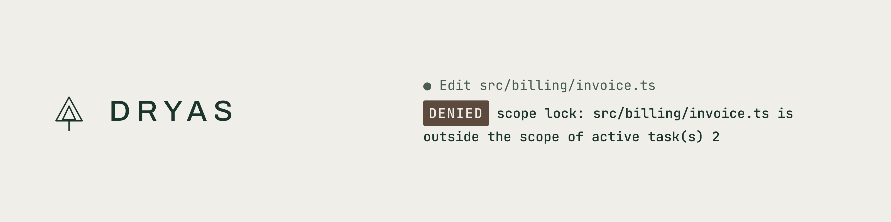
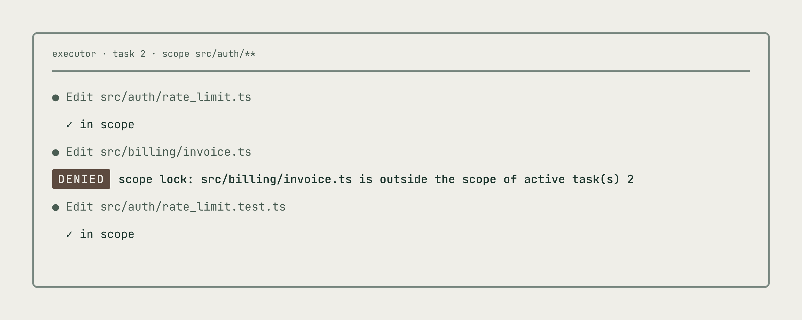
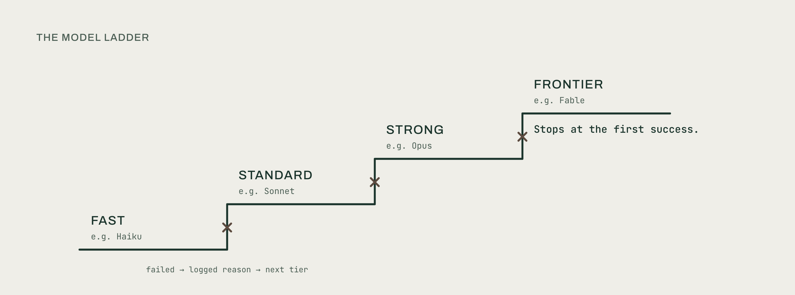
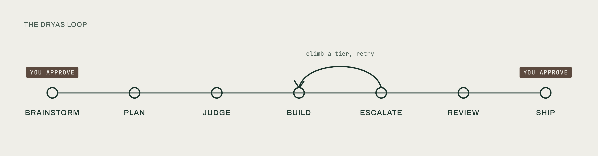
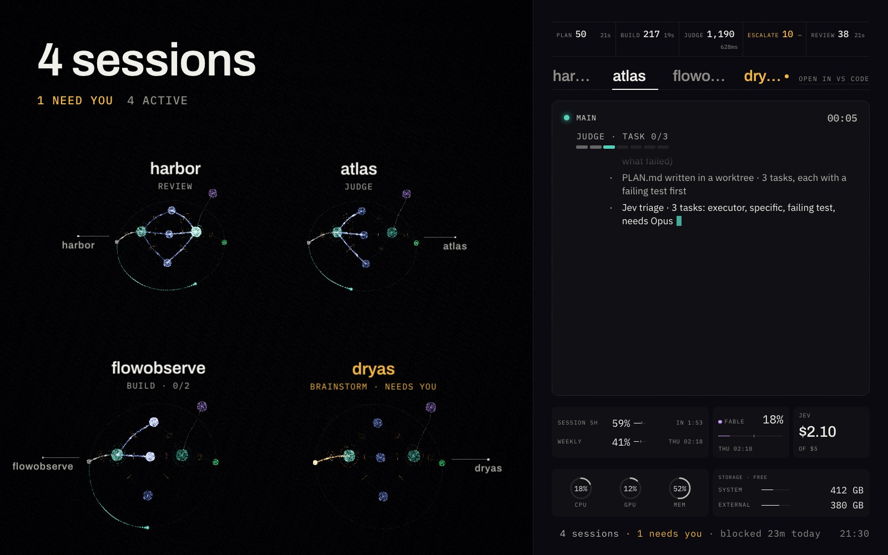

<picture><source media="(prefers-color-scheme: dark)" srcset="docs/assets/hero-dark.png"></picture>

# Rules your AI agents can't ignore.

**Stop asking your agent to behave. Make it.**

Dryas turns Claude Code and Codex into a disciplined delivery team. It agrees the design before it writes code. It edits only the files its task names. It proves the tests pass. It pays for the big model only when the small one fails. Every rule is enforced by a hook, not hoped for in a prompt.

`v2` · MIT · Claude Code · Codex · Cloud sessions · macOS, Linux, Windows

## Brilliant agents. No discipline.

- They build before anyone agreed what.
- They tidy files nobody asked about, and parallel agents overwrite each other.
- They report tests they never ran.
- They spend big-model money on small-model questions.

## Asked vs enforced

| Your agent today | With Dryas |
| --- | --- |
| Told to plan first. Starts coding anyway. | **Design gate.** Nothing is built until you approve the design. |
| Told to stay in scope. Doesn't. | **Scope lock.** A hook denies edits outside the task's files.¹ |
| Says the tests pass. | **Proof, not claims.** Executors report what they ran; review and verification gate the merge. |
| Runs everything on the default model. | **Model ladder.** Cheapest first, a stronger model only after a failure, every step logged with its reason. |
| Installs, deletes and pushes on its own. | **Judge and human gates.** Risky commands are judged; installs, deletes, pushes, overwrites and settings changes always need you. |

¹ The lock covers the file-edit tools. A write from a shell command is asked about, not blocked.

<picture><source media="(prefers-color-scheme: dark)" srcset="docs/assets/scope-lock-dark.png"></picture>

*The agent wasn't asked to stay in scope. It couldn't leave.*

<picture><source media="(prefers-color-scheme: dark)" srcset="docs/assets/ladder-dark.png"></picture>

The full comparison with installing skills side by side: [Why Dryas](docs/why-dryas.md).

## The loop

<picture><source media="(prefers-color-scheme: dark)" srcset="docs/assets/loop-dark.png"></picture>

- **Brainstorm.** The design is settled with you before any code is written. You approve it.
- **Plan.** The design becomes small tasks, each with a file scope and a done check.
- **Judge.** A small judge answers narrow questions (is this command risky? which tier?) so the big model is called less.
- **Build.** Executors on the `fast` tier do each task in its own git worktree, test first.
- **Escalate.** A failed task climbs to `standard`, then `strong`. `frontier` only after `strong` fails. Each climb is logged with a reason.
- **Review.** Fresh reviewers check the diff, and the tests are run, before anything merges.
- **Ship.** You approve the merge.

## Install in 60 seconds

```
git clone https://github.com/promprit/dryas-workflow
cd dryas-workflow
install/install.sh          # macOS, Linux, WSL
install\install.ps1         # Windows (PowerShell)
```

Then, in Claude Code:

```
/orchestrate add rate limiting to the login endpoint
```

No API key. No Node. Python 3.9+ and git.

Codex: `install/install.sh --harness codex`. Cloud sessions on claude.ai/code: [docs/cloud-sessions.md](docs/cloud-sessions.md). Every flag, several accounts, upgrade and uninstall: [docs/install.md](docs/install.md).

## What you get

| Command | What it does |
| --- | --- |
| `/orchestrate` | Runs the loop on a task: brainstorm, plan, build, review |
| `/wreview` | Three fresh reviewers check the branch: spec, quality, over-engineering |
| `/interrogate` | Two-model adversarial review for contested changes |
| `/commit` | A judged commit; it never pushes |
| `/handoff` | Saves a scored summary so you can clear the context and carry on |
| `/tune` | Weekly: reads the logs and proposes guardrail changes |
| `/retro` | Proposes lessons from a finished task; never applies them |

Underneath: a local judge that needs no key, Dryas memory that remembers what was tried, and eight process skills (brainstorm, plan, tdd, debug, verify, review-request, review-receive, worktree). Terms: [glossary](GLOSSARY.md).

## Proof: we ship with it

Dryas Studio delivers every project with Dryas, Dryas 2.0 included. Our own logs, 7 to 15 October 2026:

**1,154 tasks merged · 1,689 executor dispatches · 160 out-of-scope edits blocked**

Not a benchmark. Just the work.

[](https://dryasstudio.com/demos/flowobserve/)

*[FlowObserve](https://github.com/promprit/flowobserve) live demo (sample data): every session's stage, and the one that needs you.*

Over 2,000 tests, with CI on macOS, Linux and Windows. The keyless judge is measured on a public corpus and gated in CI: [judge scorecard](docs/judge-scorecard.md). Built and run by [Dryas Studio](https://dryasstudio.com).

## For teams

Dryas is also a target operating model for AI software delivery: roles, a RACI, metrics with healthy ranges, maturity levels L0 to L4, and a draft specification any harness can implement. Formally, the Dryas Workflow Framework.

[Operating model](docs/operating-model.md) · [Architecture](docs/architecture.md) · [Roles](docs/roles.md) · [Metrics](docs/metrics.md) · [Adoption guide](docs/adoption-guide.md) · [Specification](spec/dryas-spec-v1.md) · [Reference map](reference/README.md) · [Examples](examples/README.md) · [All docs](docs/README.md)

## Works with

| Harness | Status |
| --- | --- |
| Claude Code | Shipping: plugin `dryas@dryas-workflow` |
| Codex | Shipping: plugin `dryas@dryas-workflow` |
| Claude Code cloud sessions | Shipping: `dryas cloud init` commits the core into your repo |
| OpenCode | Next, in 2.2 |
| Pi, Roo, Cursor | Later |

macOS, Linux, WSL and Windows. Details: [harnesses](docs/harnesses.md).

## Credits

- [Superpowers](https://github.com/obra/superpowers) by obra: the Dryas process skills are derived from it
- [Ruflo](https://github.com/ruvnet/ruflo) by ruvnet: 1.x Ruflo memory imports with `dryas memory import-ruflo`
- [Impeccable](https://github.com/pbakaus/impeccable) by pbakaus and [UI UX Pro Max](https://github.com/nextlevelbuilder/ui-ux-pro-max-skill) by nextlevelbuilder: the design skills
- [TypeSafe skills (Jev)](https://github.com/typesafe-ai/skills) by TypeSafe: the optional Jev judge
- [pstack](https://github.com/cursor/plugins/tree/main/pstack) by Lauren Tan, Claude Code port [pstack-claude](https://github.com/michael-denyer/pstack-claude) by Michael Denyer, and deslop from Cursor's cursor-team-kit (all MIT); skip them with `--no-pstack-picks`

Third-party code is fetched from upstream by the installer, except the adapted pstack files in `claude/pstack/` and the process skills derived from Superpowers (see [NOTICE.md](NOTICE.md)).


## License

MIT. See [LICENSE](LICENSE).
