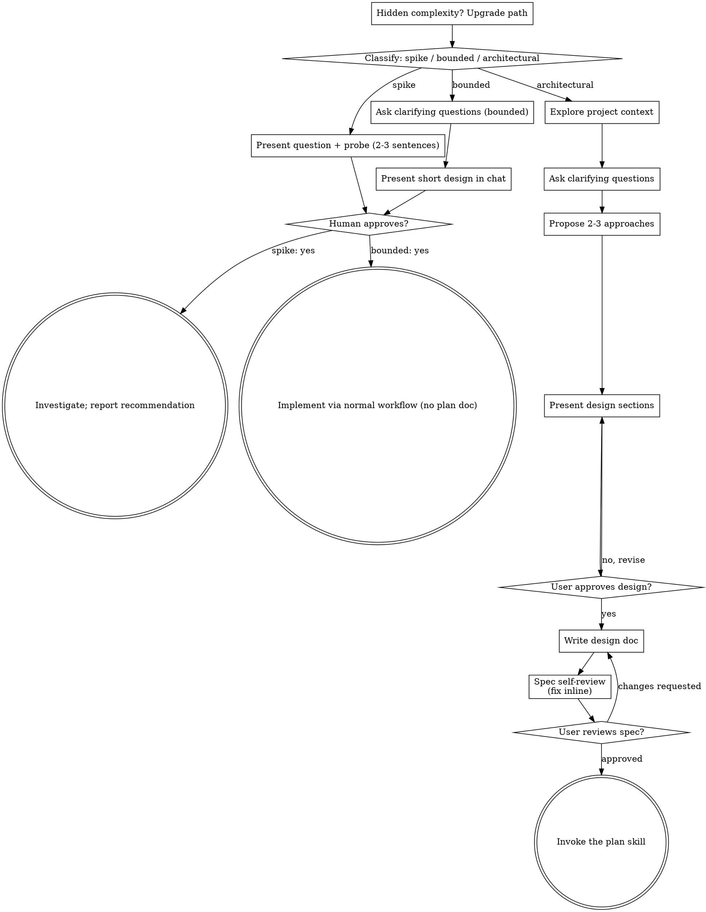

<!-- claude -->
Invoke this skill with the Skill tool as `dryas:brainstorm`; `/orchestrate` runs it first unless the request points at an approved design.
<!-- /claude -->
<!-- codex -->
On Codex: before new work, clarify intent and get the user's approval of a design. Invoke this skill as `$dryas:brainstorm`; `$dryas:orchestrate` runs it first unless the request points at an approved design.
<!-- /codex -->

# Brainstorm

Turn ideas into fully formed designs and specs through natural, collaborative dialogue. Classify how much process the request needs first, then work through that path: understand the context, refine the idea, present a design, and get your human partner's approval.

## Shared understanding

The outcome is an understanding your partner can recognize and correct, grounded in what they want to accomplish.

1. **Discover intent.** From the request and the context, identify the intended outcome, who it is for and what success looks like. When that is missing, ask one focused question about purpose or intended use before proposing features or an approach. Knowing the app genre does not tell you why your partner wants it. Gathering missing requirements does not ask them to authorize the task again.
2. **Write back your understanding.** Summarize the intended outcome, relevant constraints and success criteria in a short note your partner can assess. Separate what they said from your assumptions. Invite correction and incorporate the answer before treating the note as the design brief.
3. **Carry intent into the design.** Keep the agreed understanding in the path's design artifact (the written spec for architectural work, the in-chat design or probe for bounded work and spikes). Check proposed features and technical choices against it.

When the request already supplies purpose and constraints, reflect that understanding instead of asking the same questions again. Keep the note concise; its accuracy and the chance to correct it are what matter.

## Hard gate

Before any implementation action (invoking an implementation skill, writing product code, scaffolding, installing product dependencies, creating an external project, dispatching an executor), complete the selected path's prerequisites:

- **Spike:** the partner approves the question and the probe.
- **Bounded:** the partner approves the short in-chat design.
- **Architectural:** the partner reviews and approves the written spec, then reviews the written implementation plan; the plan's execution method in Dryas is `/orchestrate`. Conversational design approval only permits writing the spec; written-spec approval only permits invoking the `dryas:plan` skill (`/wplan`).

A reply approves the stage actually presented. Approval of an idea or a feature scope does not approve artifacts that do not exist yet. Resume at the earliest incomplete stage; never turn one approval into permission to skip the rest of the path. Read-only project exploration is allowed while prerequisites are incomplete.

## Three paths

Before your first question, classify the request and say the classification out loud ("this looks bounded, so I'll present a short design here rather than write a spec") so your partner can override it.

- **Spike**: a feasibility question ("can we...", "is it possible...", "quick and dirty is fine") whose output is an answer, not code you keep. Present the question and what you will try in 2-3 sentences, get a nod, then find out as cheaply as correctness allows. No design doc, no spec file. Report findings as a recommendation; anything you built stays labeled throwaway.
- **Bounded**: a well-scoped change to code that already exists in this repo (a new flag, a small endpoint, a one-file fix). Understanding the kind of app is not enough: bounded means the flow you are changing is already here to read. No existing flow to change means not bounded. Ask the clarifying questions that matter, present a short design IN CHAT (a few sentences to a few short paragraphs), and STOP. Implementation starts only after your partner says yes to that design; a bounded approval is as hard a gate as an architectural one. No spec file, no plan document.
- **Architectural**: new projects, new subsystems, changes that restructure how components fit together or alter interfaces others depend on. Full process: questions, approaches, sectioned design, written spec, then the `dryas:plan` skill.

In doubt between two paths, take the heavier one. The ratchet is one-way: hidden complexity found mid-task upgrades the path (stop, say so, step up). Nothing downgrades mid-task.

## Too simple to need approval

Anti-pattern. Every path ends with your partner approving the required design before implementation. A bounded change may need only two sentences in chat. A new todo-list project is architectural and needs the written spec and the planning hand-offs. Scale the artifact to the path; complete that path's reviews before implementation.

## Red flags

| Thought | Reality |
|---|---|
| "This is too simple to need a design" | Follow the path: bounded gets a short chat design; architectural gets the written spec and planning hand-offs. |
| "I'll call it bounded and skip the spec" | Reaching for a label to skip work IS the doubt: take the heavier path. |
| "It's bounded and the design is obvious, I'll start while they read it" | The gate is the approval, not the design's length. Present, then stop until you hear yes. |
| "I understand this kind of app, so it's bounded" | Bounded measures the repo, not your familiarity. A new project has no existing flow: architectural. |
| "The spike works, so I'll keep the code" | A spike's output is an answer. Keeping the code is a new request: classify it. |
| "It grew, but I'm almost done, no need to re-classify" | Hidden complexity upgrades the path mid-task. Stop and say so. |
| "They approved the spike, so the follow-up change is approved too" | Each task gets its own classification and its own approval. |

## Checklist

Classify first, announce the path, then create a task for each item on your path and complete them in order.

**Spike:**
1. Explore project context: enough to frame the probe.
2. Present question and probe plan: 2-3 sentences.
3. Get approval: a nod is enough.
4. Investigate: as cheaply as correctness allows.
5. Report findings: a recommendation; label anything built as throwaway.

**Bounded:**
1. Explore project context: files, docs, recent commits.
2. Ask clarifying questions: one at a time, the ones that matter.
3. Present a short design in chat: approach, files touched, testing.
4. Get approval: STOP and wait for an explicit yes; presenting the design and starting in the same breath is skipping the gate.
5. Implement: the normal development workflow (test first applies); no plan document.

**Architectural:**
1. Explore project context: files, docs, recent commits.
2. Ask clarifying questions: one at a time; purpose, constraints, success criteria.
3. Propose 2-3 approaches: trade-offs and your recommendation.
4. Present the design: in sections scaled to their complexity; get approval after each section.
5. Write the design doc: see "After the design"; commit it.
6. Spec self-review: quick inline check for placeholders, contradictions, ambiguity, scope.
7. User reviews the written spec: ask before proceeding.
8. Transition to implementation: invoke the `dryas:plan` skill to write the implementation plan.

## Process flow

**Terminal states are path-bound.** Architectural: the ONLY skill you invoke after brainstorming is the `dryas:plan` skill, never a frontend-design, mcp-builder or other implementation skill. Bounded: after approval, implementation goes straight through the normal development workflow; no plan document. Spike: the terminal state is a reported recommendation.

## The process

These steps serve the bounded and architectural paths (a spike stops at "present the probe, get a nod"). From **Exploring approaches** on it is architectural depth; for bounded work, context plus a few questions plus a short in-chat design is the whole process.

**Understanding the idea:**
- Check the current project state first (files, docs, recent commits).
- Before detailed questions, assess scope: if the request describes several independent subsystems ("a platform with chat, file storage, billing and analytics"), flag it at once. Do not spend questions refining details of a project that must be decomposed first.
- If it is too large for one spec, help decompose it into sub-projects: the independent pieces, how they relate, the build order. Then brainstorm the first sub-project through the normal flow. Each sub-project gets its own spec, plan and implementation cycle.
- For well-scoped projects, ask questions one at a time to refine the idea.
- Prefer multiple-choice questions; open-ended is fine too.
- One question per message; if a topic needs more, break it into several questions.
- Focus on understanding purpose, constraints and success criteria.

**Exploring approaches:**
- Propose 2-3 different approaches with trade-offs.
- Present them conversationally with your recommendation and reasoning.
- Lead with the recommended option and say why.
- YAGNI ruthlessly: remove unnecessary features from every approach and design.

**Presenting the design:**
- Once you believe you understand what you are building, present the design.
- Scale each section to its complexity: a few sentences if straightforward, up to 200-300 words if nuanced.
- Ask after each section whether it looks right so far.
- Cover architecture, components, data flow, error handling, testing.
- Be ready to go back and clarify when something does not make sense.

**Design for isolation and clarity:**
- Break the system into smaller units, each with one clear purpose, communicating through well-defined interfaces, understandable and testable on its own.
- For each unit you can answer: what does it do, how is it used, what does it depend on?
- Can someone understand a unit without reading its internals? Can its internals change without breaking consumers? If not, the boundaries need work.
- Small, well-bounded units are easier for you too: you reason better about code you can hold in context, and edits are more reliable in focused files. A file growing large often signals it does too much.

**Working in existing codebases:**
- Explore the current structure before proposing changes. Follow existing patterns.
- Where existing code has problems that affect the work (an oversized file, unclear boundaries, tangled responsibilities), include targeted improvements in the design, as a good developer improves code they work in.
- Do not propose unrelated refactoring. Stay on the current goal.

Design work (UI/UX, layout, visual style, components, on-screen copy) also uses the design skills the rules name, when installed.

## After the design

Architectural path.

**Documentation:**
- Save the spec as `docs/specs/YYYY-MM-DD-<topic>-design.md` (or under `docs/superpowers/specs/` if the project uses that), commit it, and review it with `${CLAUDE_PLUGIN_ROOT}/skills/brainstorm/spec-reviewer-prompt.md` before asking the user to read it.
- User preferences for the spec location override this default.
- Use a writing-clearly-and-concisely skill (elements-of-style) if available.

**Spec self-review**, with fresh eyes, right after writing it:
1. **Placeholder scan:** any "TBD", "TODO", incomplete section or vague requirement? Fix it.
2. **Internal consistency:** do sections contradict each other? Does the architecture match the feature descriptions?
3. **Scope check:** focused enough for a single implementation plan, or does it need decomposition?
4. **Ambiguity check:** could a requirement be read two ways? Pick one and make it explicit.

Fix issues inline; no need to re-review, just fix and move on.

**User review gate:** after the review passes, ask the user to review the written spec before going on:

> "Spec written and committed to `<path>`. Please review it and let me know if you want any changes before we write the implementation plan."

Wait for the response. If they ask for changes, make them and re-run the review. Proceed only once the user approves.

**Implementation:**
- Invoke the `dryas:plan` skill (`/wplan`) to write the detailed implementation plan.
- Do NOT invoke any other skill. The plan skill is the next step.

The upstream browser-based visual companion (mockups and diagrams in a browser tab) is Node-based and not part of Dryas; it stays available by installing Superpowers.

## Contested

The written spec states `Contested: yes` or `Contested: no`: yes when it changes a numbered rule, an interface other modules depend on, or how components fit together. `/orchestrate` reads it to decide on `/interrogate`.
