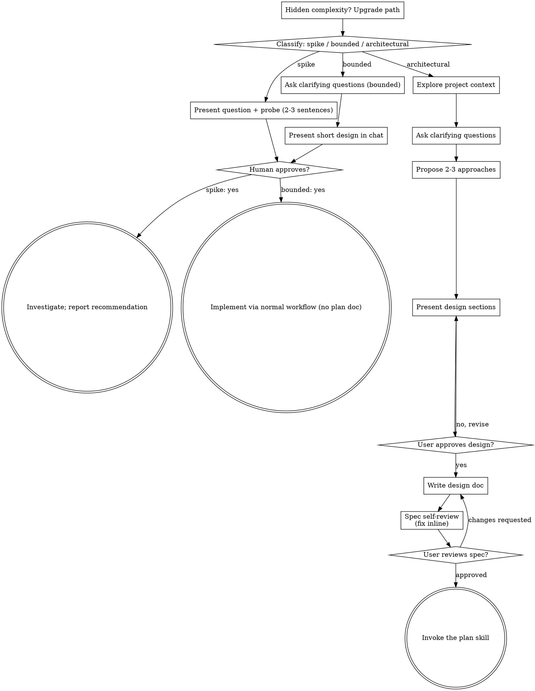

# Brainstorm reference

Read the section the pointer in `SKILL.md` names; nothing here is needed on every turn.

## Too simple to need approval

Anti-pattern. Every path ends with your partner approving the required design before implementation. A bounded change may need only two sentences in chat. A new todo-list project is architectural and needs the written spec and the planning hand-offs. Scale the artifact to the path; complete that path's reviews before implementation.

## Process flow

## Understanding the idea

- Check the current project state first (files, docs, recent commits).
- Before detailed questions, assess scope: if the request describes several independent subsystems ("a platform with chat, file storage, billing and analytics"), flag it at once. Do not spend questions refining details of a project that must be decomposed first.
- If it is too large for one spec, help decompose it into sub-projects: the independent pieces, how they relate, the build order. Then brainstorm the first sub-project through the normal flow. Each sub-project gets its own spec, plan and implementation cycle.
- Focus the questions on purpose, constraints and success criteria.

## Exploring approaches

- Propose 2-3 different approaches with trade-offs.
- Present them conversationally with your recommendation and reasoning.
- Lead with the recommended option and say why.
- YAGNI ruthlessly: remove unnecessary features from every approach and design.

## Presenting the design

- Once you believe you understand what you are building, present the design.
- Scale each section to its complexity: a few sentences if straightforward, up to 200-300 words if nuanced.
- Ask after each section whether it looks right so far.
- Cover architecture, components, data flow, error handling, testing.
- Be ready to go back and clarify when something does not make sense.

## Design for isolation and clarity

- Break the system into smaller units, each with one clear purpose, communicating through well-defined interfaces, understandable and testable on its own.
- For each unit you can answer: what does it do, how is it used, what does it depend on?
- Can someone understand a unit without reading its internals? Can its internals change without breaking consumers? If not, the boundaries need work.
- Small, well-bounded units are easier for you too: you reason better about code you can hold in context, and edits are more reliable in focused files. A file growing large often signals it does too much.

## Working in existing codebases

- Explore the current structure before proposing changes. Follow existing patterns.
- Where existing code has problems that affect the work (an oversized file, unclear boundaries, tangled responsibilities), include targeted improvements in the design, as a good developer improves code they work in.
- Do not propose unrelated refactoring. Stay on the current goal.

## Spec self-review

With fresh eyes, right after writing the spec:

1. **Placeholder scan:** any "TBD", "TODO", incomplete section or vague requirement? Fix it.
2. **Internal consistency:** do sections contradict each other? Does the architecture match the feature descriptions?
3. **Scope check:** focused enough for a single implementation plan, or does it need decomposition?
4. **Ambiguity check:** could a requirement be read two ways? Pick one and make it explicit.

Fix issues inline; no need to re-review, just fix and move on.

## Spec documentation

- User preferences for the spec location override the default path.
- Use a writing-clearly-and-concisely skill (elements-of-style) if available.
- The upstream browser-based visual companion (mockups and diagrams in a browser tab) is Node-based and not part of Dryas; it stays available by installing Superpowers.
