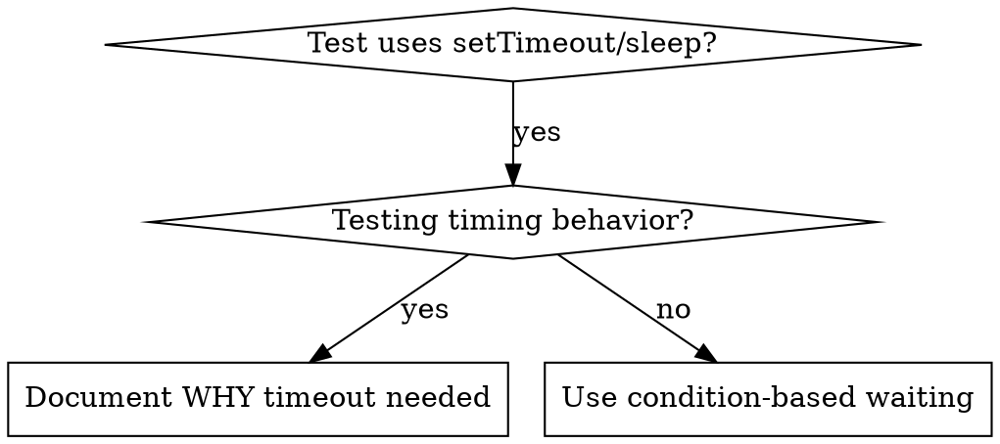

# Condition-based waiting

Part of `<dryas-root>/../skill/dryas-debug/SKILL.md`: for flaky tests and timing bugs.

## Overview

Flaky tests often guess at timing with arbitrary delays. That creates race conditions: tests pass on fast machines and fail under load or in CI.

**Core principle:** wait for the actual condition you care about, not a guess about how long it takes.

## When to use



Use when:
- Tests have arbitrary delays (`setTimeout`, `sleep`, `time.sleep()`)
- Tests are flaky (pass sometimes, fail under load)
- Tests time out when run in parallel
- Waiting for async operations to complete

Do not use when:
- Testing actual timing behavior (debounce, throttle intervals)
- Then always document WHY you use an arbitrary timeout

## Core pattern

```typescript
// BEFORE: guessing at timing
await new Promise(r => setTimeout(r, 50));
const result = getResult();
expect(result).toBeDefined();

// AFTER: waiting for the condition
await waitFor(() => getResult() !== undefined);
const result = getResult();
expect(result).toBeDefined();
```

## Quick patterns

| Scenario | Pattern |
|---|---|
| Wait for event | `waitFor(() => events.find(e => e.type === 'DONE'))` |
| Wait for state | `waitFor(() => machine.state === 'ready')` |
| Wait for count | `waitFor(() => items.length >= 5)` |
| Wait for file | `waitFor(() => fs.existsSync(path))` |
| Complex condition | `waitFor(() => obj.ready && obj.value > 10)` |

## Implementation

A generic polling function:

```typescript
async function waitFor<T>(
  condition: () => T | undefined | null | false,
  description: string,
  timeoutMs = 5000
): Promise<T> {
  const startTime = Date.now();

  while (true) {
    const result = condition();
    if (result) return result;

    if (Date.now() - startTime > timeoutMs) {
      throw new Error(`Timeout waiting for ${description} after ${timeoutMs}ms`);
    }

    await new Promise(r => setTimeout(r, 10)); // Poll every 10ms
  }
}
```

Domain-specific helpers follow the same shape: wait for an event of a type, for N events of a type, or for the first event matching a predicate, each polling fresh state with a timeout and a descriptive error.

## Common mistakes

- **Polling too fast** (`setTimeout(check, 1)`) wastes CPU. Fix: poll every 10ms.
- **No timeout** loops forever if the condition is never met. Fix: always include a timeout with a clear error.
- **Stale data** (state cached before the loop). Fix: call the getter inside the loop for fresh data.

## When an arbitrary timeout IS correct

```typescript
// Tool ticks every 100ms - need 2 ticks to verify partial output
await waitForEvent(manager, 'TOOL_STARTED'); // First: wait for condition
await new Promise(r => setTimeout(r, 200));   // Then: wait for timed behavior
// 200ms = 2 ticks at 100ms intervals - documented and justified
```

Requirements:
1. First wait for the triggering condition
2. Based on known timing (not guessing)
3. A comment explaining WHY

## Real-world impact

From a debugging session (2025-10-03): 15 flaky tests fixed across 3 files; pass rate 60% → 100%; execution 40% faster; no more race conditions.
