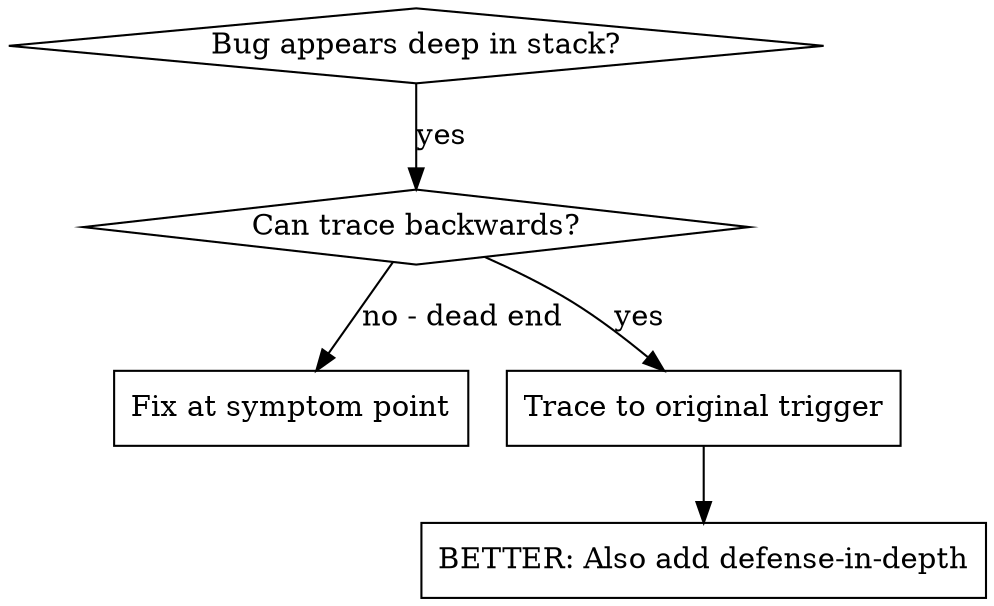
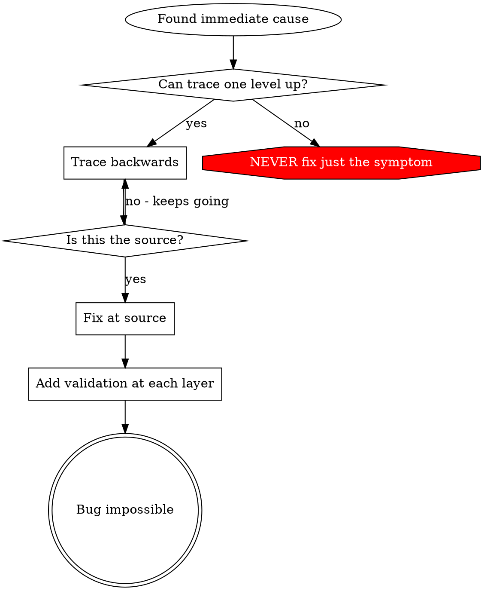

# Root cause tracing

Part of `<dryas-root>/../skill/dryas-debug/SKILL.md` (Phase 1, step 5).

## Overview

Bugs often show up deep in the call stack (git init in the wrong directory, a file created in the wrong place, a database opened with the wrong path). The instinct is to fix where the error appears; that treats a symptom.

**Core principle:** trace backward through the call chain to the original trigger, then fix at the source.

## When to use



Use when:
- The error happens deep in execution (not at the entry point)
- The stack trace shows a long call chain
- It is unclear where the invalid data originated
- You need to find which test or code triggers the problem

## The tracing process

### 1. Observe the symptom
```
Error: git init failed in ~/project/packages/core
```

### 2. Find the immediate cause
What code directly causes this?
```typescript
await execFileAsync('git', ['init'], { cwd: projectDir });
```

### 3. Ask: what called this?
```typescript
WorktreeManager.createSessionWorktree(projectDir, sessionId)
  → called by Session.initializeWorkspace()
  → called by Session.create()
  → called by test at Project.create()
```

### 4. Keep tracing up
What value was passed?
- `projectDir = ''` (empty string!)
- An empty string as `cwd` resolves to `process.cwd()`
- That is the source code directory!

### 5. Find the original trigger
Where did the empty string come from?
```typescript
const context = setupCoreTest(); // Returns { tempDir: '' }
Project.create('name', context.tempDir); // Accessed before beforeEach!
```

## Adding stack traces

When you cannot trace by hand, add instrumentation before the problematic operation:

```typescript
async function gitInit(directory: string) {
  const stack = new Error().stack;
  console.error('DEBUG git init:', {
    directory,
    cwd: process.cwd(),
    nodeEnv: process.env.NODE_ENV,
    stack,
  });

  await execFileAsync('git', ['init'], { cwd: directory });
}
```

**Critical:** in tests use `console.error()` (or the language's stderr), not a logger; a logger may not show.

Run and capture:
```bash
npm test 2>&1 | grep 'DEBUG git init'
```

Analyze the stack traces:
- Look for test file names
- Find the line number that triggers the call
- Identify the pattern (same test? same parameter?)

## Find the polluter

Something appears during the test run (a stray `.git`, a file, changed shared state) and you do not know which test makes it. Find it by running the tests one at a time, in their normal order, and checking for the pollution after each:

1. List the test files matching the suite's pattern, sorted (a pattern like `src/**/*.test.ts` must also match files directly under `src/`).
2. For each file in order: if the pollution already exists, say so and skip the file (clean it up first, or the check proves nothing); otherwise run that one test file, ignoring its result.
3. After each run, check for the pollution. The first file after which it appears is the polluter: stop, show the artifact, and investigate by running just that test and reading its code.
4. No file produced it: report that all tests are clean.

```bash
# usage: find the test that creates <artifact>
for f in $(find . -path './src/*' -name '*.test.ts' | sort); do
  [ -e "$ARTIFACT" ] && { echo "pollution already exists, skipping $f"; continue; }
  npm test "$f" > /dev/null 2>&1 || true
  [ -e "$ARTIFACT" ] && { echo "FOUND POLLUTER: $f"; ls -la "$ARTIFACT"; exit 1; }
done
echo "No polluter found"
```

With a long suite, bisect the order instead: run the first half, check, and keep halving the half that produces it.

## Real example: empty projectDir

**Symptom:** `.git` created in `packages/core/` (source code).

**Trace chain:**
1. `git init` runs in `process.cwd()` ← empty cwd parameter
2. WorktreeManager called with an empty projectDir
3. Session.create() passed an empty string
4. The test accessed `context.tempDir` before beforeEach
5. setupCoreTest() returns `{ tempDir: '' }` initially

**Root cause:** top-level variable initialization reading an empty value.

**Fix:** made tempDir a getter that throws if accessed before beforeEach.

**Also added defense in depth** (`<dryas-root>/../skill/dryas-debug/defense-in-depth.md`):
- Layer 1: Project.create() validates the directory
- Layer 2: WorkspaceManager validates not empty
- Layer 3: a NODE_ENV guard refuses git init outside tmpdir
- Layer 4: stack trace logging before git init

## Key principle



**NEVER fix just where the error appears.** Trace back to the original trigger.

## Stack trace tips

- **In tests:** use `console.error()`, not a logger; a logger may be suppressed.
- **Before the operation:** log before the dangerous operation, not after it fails.
- **Include context:** directory, cwd, environment variables, timestamps.
- **Capture the stack:** `new Error().stack` shows the complete call chain.

## Real-world impact

From a debugging session (2025-10-03): root cause found through a 5-level trace; fixed at the source (getter validation); 4 layers of defense added; 1847 tests passed, zero pollution.
